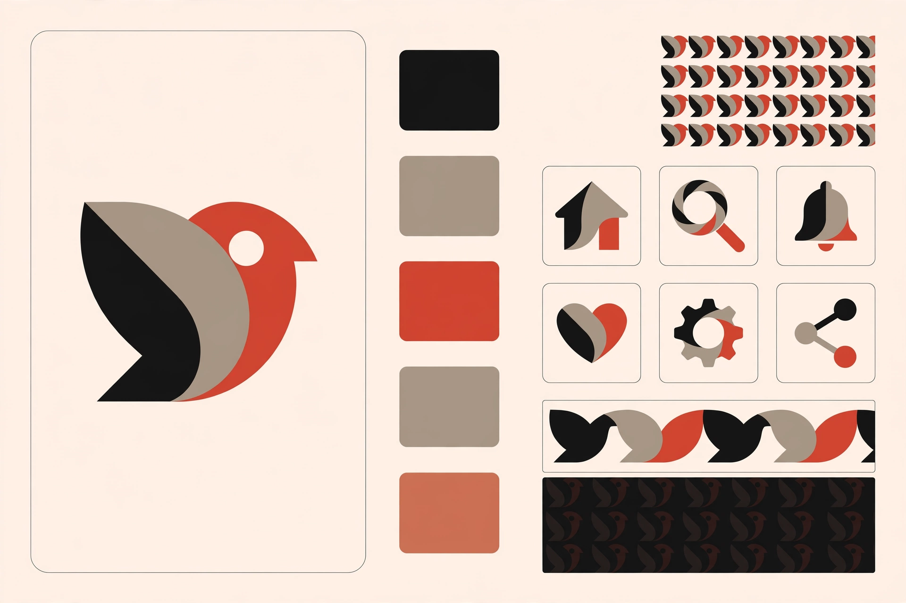

# Style Dataset Builder Skill

一个给 AI 助手用的风格 LoRA 数据集准备工作流 skill，由 `SKILL.md` + `skill.yaml` 两个文件组成。

A dataset-prep workflow for style LoRAs: check the base model's commercial license first, lock a trigger word, decompose the style into ten recordable dimensions, annotate human-edited before/after pairs, then run a fixed series-expansion pipeline.

## 它解决什么问题

练风格 LoRA 的人大多卡在同一步：教程都在讲训练参数，没人讲数据怎么备。结果是图攒了一堆，风格还是学不像。这个 skill 把准备工作拆成可执行的流程：

1. **先过商用许可关** — LoRA 是底座的衍生品，许可跟底座走。用非商用底座练得再好也不能商用，这一步必须在动手前查清，文内附可商用底座举例。
2. **把"感觉"拆成十个维度** — 色板 hex、质感、母题、构图、留白、描边等逐项记录，填满 20 张后提炼出"风格锁"，风格从此可锁定、可复用。
3. **用 before/after 对子做最高质量数据** — AI 原图加人工改版，配套标注表字段（改了什么、为什么改、质量分），改图的过程本身就是在教模型你的审美。
4. **靠变换手法衍生不同方案** — 一张主视觉进，只用五种手法（平铺、拆件重组、横向流动、降对比铺底、局部放大）衍生出纹样、功能 icon、横幅、背景。只换组合不换风格锁，同一母题能出多套方案。

## 状态

v1，数据集准备阶段的方法。作者正在按这套流程攒数据，第一次训练完成后会更新 v2，记录哪些字段真正有用、哪些是浪费。欢迎提 issue 分享你的标注字段改法。

## 怎么用

先装上：把 `SKILL.md` 和 `skill.yaml` 放进一个名为 `style_dataset_builder` 的文件夹，再把文件夹放到你的 AI 助手加载自定义 skill 的目录。触发词在文内写作 `yourstyle`，换成你自己的专属词。

装好之后，设计师的动线只有五步。记住一句话：你只负责出图和拍板，拆解、标注、生成这些活都是助手干。

1. 跟助手说一句"用 style_dataset_builder 帮我备一套风格数据"，它就进入这套流程。
2. 喂图：给它一张你定好的主视觉，再加上过去做过的同风格图 20–60 张。它把风格拆成十个维度、填好标注表，提炼出风格锁（色板、触发词、形状件清单），你看一眼确认"对，这就是我的风格"。
3. 日常攒对子：平时用 AI 出图，你改了哪儿、为什么改，随口告诉它，它记成改版对子。不用专门坐下来整理，顺手攒。
4. 攒到 50 对以上再开训：在你惯用的 LoRA 训练工具里训练，底座只选可商用的。之前别急，数据不够训出来也是废的。
5. 训好后日常用：给它一张新主视觉，它按五种变换手法衍生出一整套纹样、功能 icon、横幅、背景，你终审。改过的版本回流成新对子，越用越像你的手。

## 免责声明

文中底座模型的许可举例为写作时的公开信息，模型许可可能变更，选型时请以官方最新许可文本为准。训练数据的版权责任由使用者自行确认，本流程不构成法律建议。

## License

MIT
